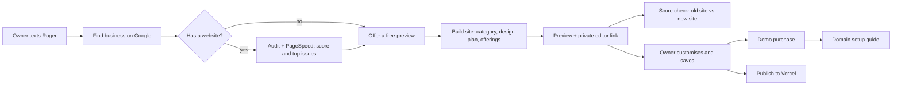
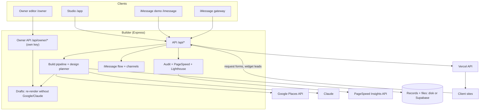

# Roger Site Builder: Project Overview

Roger texts local business owners, checks their current website, and builds them a new one from their Google Business profile in under a minute. The owner can then customise it, save it, buy it (demo checkout) and set up their own domain. This document explains what the project does, how it is built, how to run and deploy it, and what comes next. The [README](README.md) is the detailed technical reference (every API parameter, theme key and pipeline rule); [docs/design-directions.md](docs/design-directions.md) describes the design system.

| | |
|---|---|
| **Live builder** | https://roger-site-builder.vercel.app (password protected; runs the `main` branch) |
| **Code** | github.com/faisalv149/roger-site-builder (private). Current work is on branch `feature/personalisation-plumbing`, not yet committed or deployed |
| **Hosting** | Vercel, team `veetech2`. The builder is one project; each published client site is its own project |
| **Storage** | Supabase on Vercel (records and generated files); JSON files and folders locally |
| **Stack** | Node 22.19+, TypeScript, Express, vanilla JS front ends, Playwright Chromium, Lighthouse |

---

## 1. What Roger does

1. A business owner texts Roger, or Roger reaches out.
2. Roger finds the business on Google ("Is this you?").
3. If the business has a website, Roger audits it (Roger's checks plus Google PageSpeed Insights) and sends a score with the top problems.
4. Roger builds a new website from the Google profile (photos, reviews, hours, services), designed for that kind of business: a plumber, a salon, a café, a gym, a consultant, a shop or anything else.
5. Roger sends the preview, then a private link to the owner's editor, then a score check: the current site against the new site, measured the same way.
6. In the editor the owner customises colours, fonts, layout and prices, saves, and can go through a demo purchase and guided domain setup.
7. The Studio team can publish the site to Vercel as a real, standalone website.



Every Roger message with a link has a purpose-made 1200×630 share image, so iMessage shows a rich preview.

---

## 2. What is built

### Site builder
- **Input:** a business name and ZIP, a Google Maps link, a short `maps.app.goo.gl` link, or a place ID.
- **Data:** Google Places (details, photos, reviews, hours, nearby towns). If the business has a website, Roger also scans it for the logo, brand colours, fonts, services and any prices it states.
- **Claude** (model `claude-sonnet-5-5`, through the API or the local Claude Code CLI) extracts stated facts (years, licensed, insured, warranty, 24h), the business's own services, prices only when the website states them exactly, and constrained design advice. Every Claude suggestion is validated; deterministic rules decide when it is missing or invalid.
- **Output:** one self-contained static site per business (`out/sites/<slug>/`): HTML with inline CSS/JS, art-directed WebP photo crops, favicon, share image, screenshot and JSON-LD.
- **Speed:** about 1 second with sample data; about 30–60 seconds live in the Studio (including the website audit and scoring the new site), faster in iMessage where scoring runs after the preview is sent.

### Business categories
Roger works for any local business. The Google category decides the wording, the main action and what the page emphasises (`src/design/categories.ts`):

| Category | Examples | Offerings title | Main actions |
|---|---|---|---|
| Trades | plumber, electrician, roofer, HVAC | Services | Call, Request a quote, Request an appointment |
| Salon | hair, nails, barber, spa | Treatments and prices | Request an appointment |
| Food | café, restaurant, bakery | Menu | Call us, Order enquiry |
| Fitness | gym, studio | Memberships and classes | Ask about membership, Request a class |
| Professional | consultant, accountant | Services and packages | Send an enquiry, Request a consultation |
| Shop | any store | What we stock | Ask about an item |
| General | anything else | What we offer | Send an enquiry, Call us |

Unknown or sparse businesses (no phone, no photos, no reviews) still get a clean, valid page.

### Offerings and prices
- **Price kinds:** fixed (`$38`), from (`From $65`), range (`$180–$260`), per unit (`$59 / month`) and on request. Currencies are formatted for their locale (USD, GBP, EUR, AUD and others).
- **Where prices come from:** the business's own website, or the owner in the editor. Roger never invents a price. Without one, the page says "Request a quote" or "Price on request" in the category's words.
- **Owner edits** are validated on the server (no negative amounts, no impossible ranges, text cleaned).

### Design system
A versioned **design plan** (`src/design/schema.ts`, `planner.ts`) is created for every build and saved with it:
- **Four directions:** Clean professional, Warm local, Bold practical, Editorial showcase. Each sets surfaces, type pairing, spacing, shapes and section styles. The 36 themes still supply copy patterns and trade services.
- **Choices per plan:** hero (text and photo, large photo, typography-led, photo carousel), section order, density, offerings layout (cards, price list, plans, checklist, compact list, index) and gallery (grid, masonry, strip, large feature). Photos are labelled and assigned to roles (hero, team, gallery) so no photo is used twice.
- **Stability:** a plan has a seed. Rebuilding or reopening a site keeps the same design. "Generate another design" picks a new seed and differs from recent designs in at least two ways, while keeping the owner's prices, wording, answers and any layout choices they locked.
- **Accessibility and motion:** contrast is checked for every colour and gradient; the carousel follows the WAI-ARIA carousel pattern (manual, keyboard and touch); motion has Off / Subtle / Expressive levels and always respects "reduce motion".

### Owner editor (`/owner/?d=<draft>#k=<key>`)
The owner's private editor for their site (`public/owner/`, `src/drafts.ts`, `src/owner-api.ts`):
- **Preview** of the real site, with a floating owner toolbar (a compact bar plus bottom sheet on phones): Customise, Save design, Buy this website, minimise.
- **Customise:** colours (brand presets, own colour, solid or gradient with direction), fonts (curated pairs, text size), layout (style, hero, section order, gallery, offerings layout, Generate another design), details (buttons, corners, spacing), motion, and prices.
- **Fast changes:** colour and font changes apply instantly as validated CSS variables; layout and price changes re-render from the saved draft. Neither calls Google or Claude again.
- **Saving:** Undo and Reset; save states (unsaved, saving, saved, not saved); unsaved work is kept on the device after a network error; a revision check stops an older tab from overwriting newer work.
- **Scores:** a card shows the current website against the new site (website check, Google speed, accessibility, SEO, how fast the main content appears).
- **Access:** the link carries a random key in the URL fragment, never sent to the server in the URL. Only its hash is stored. It opens only that draft's editing, order and domain steps. The Studio can issue a new link (replacing the old one) or revoke it. Forms in the preview are switched off while editing, and the published site never contains editor code or keys.

### Demo purchase and domain setup
Clearly labelled demos: no payment provider, no card details, no domain purchase, no DNS change and no deployment (`src/orders.ts`).
- **Checkout:** review (saved design, version, features, a configurable "Demo price" package), owner details with a preset "Demo payment · demo card ending 4242", then confirm. "Demo checkout — no payment will be taken" is shown throughout. The order freezes the purchased design and is idempotent (a retry never creates a second order).
- **Domain setup:** three choices. *Connect a domain* asks for the domain and the DNS provider (explained as distinct from the registrar), then walks through sign-in, DNS records, the A and CNAME records (placeholders until the real Vercel values exist, copy disabled), ownership verification and DNS/HTTPS checks. It keeps existing MX and TXT records and never asks to change nameservers. *I need a domain* gives guidance and example names (availability not checked). *Do this later* saves progress. "Simulate DNS verification" completes the demo; the real flags (domain verified, certificate ready, published) stay false.

### Website audit and scores
- **Roger's checks:** security, speed, mobile, Google search, accessibility, getting leads, and trust (does the website match Google?). The result is a score out of 100 with issues ranked by severity, a public report page and a score card image.
- **Google PageSpeed Insights:** phones and computers in parallel, with all four Lighthouse scores, Core Web Vitals, real-visitor data when Google has it, and every failing check with its estimated saving. Results are cached for 30 minutes.
- **The new site** is scored with the same checks. A preview Google can't reach is measured with Lighthouse (the same version Google uses) in this server's Chrome; a public URL uses Google's PageSpeed. The comparison appears in the Studio, in the report page link the owner already has, in a follow-up iMessage and in the owner editor.

### iMessage flow
- **Conversation:** the reference flow is in `src/imessage/flow.ts`: start → find business → confirm → audit or offer → build → preview → editor link → score check. Optional questions (main service, main action, style) refine the design. Conversations and their state are saved, so a restart continues where it left off.
- **Channels:** replies go through a channel adapter (`src/channels.ts`): the iMessage gateway (`IMESSAGE_OUTBOUND_URL`) or an in-memory mock for tests. Roger does not connect to Apple's service itself; a gateway you run does.
- **Demo page:** `/imessage` is an iPhone Messages look-alike that stands in for the gateway. It also shows messages Roger sends later, like the score check.

### Features on every generated site
- **Review slider** (2+ Google reviews), **photo gallery** with a full-screen viewer, and an accessible **photo carousel** where the design uses one.
- **Roger widget** (Book, Chat, Call or Call back). It never shows an invented phone number: without a real one it offers a call back.
- **Request form** matched to the main action (quote, appointment request, order enquiry, enquiry). Submissions are saved and optionally forwarded to a webhook.
- **Preview builds** carry a "free draft" banner and are hidden from search engines (`noindex`).

### Roger Site Studio (`/app/`)
The internal web app for the team:
- **New site panel:** find a business, add its website, pick or upload a theme, build, with a time estimate.
- **Sites:** every build as a card with screenshot, Preview/Live badge, old and new site scores, search, Publish, and a ⋯ menu.
- **Build:** the result first (thumbnail, badges, actions), the current site vs. new site table, the design plan with "why this design", Personalise, Try a different design, Owner editor link, then details and build steps.
- **Preview** (desktop, tablet, phone), **Audit** (score, comparison, PageSpeed, issues), **Messages** (the cards Roger sends), **Simulator** and **JSON**.

### Publishing
- **Publish** deploys a site to its own Vercel project (`roger-<slug>.vercel.app`) through the Vercel REST API; re-publishing uploads only changed files. **Unpublish** deletes that project. **Delete site** unpublishes, then removes the pages, images, report and history.
- The owner's demo purchase does not publish anything; publishing stays a Studio action.

---

## 3. Architecture



- **Builder:** one Express app (`src/server.ts`). On Vercel it runs as a function; elsewhere it is a normal Node server.
- **Storage:** `src/store.ts` holds records (builds, conversations, publishes, leads, drafts, demo orders) and `src/files.ts` the generated files. Locally they go to `data/` and `out/`; on Vercel to Supabase. All storage changes are additive, and older records are upgraded on read.
- **Drafts** keep everything a page is composed from (business data, analysed photos, theme, plan, appearance, offerings), so edits and rebuilds don't need new Google or Claude calls.
- **Screenshots and Lighthouse** use Chrome locally. On Vercel, screenshots use `@sparticuz/chromium`, and new-site scores use Google PageSpeed against the public preview URL.
- **Security:** `STUDIO_PASSWORD` (HTTP Basic, user `roger`) protects the Studio, the iMessage page and the API. The owner editor and its API use the per-draft owner key instead, are marked `noindex`, can't be framed by other sites, and refuse repeated wrong keys. Generated sites, cards, reports, the lead endpoint and the health check stay public.

---

## 4. Repository layout

```
src/
  server.ts        Express app: routes, auth, static files
  pipeline.ts      the build, step by step
  drafts.ts        owner drafts: compose, re-render, save, owner keys
  owner-api.ts     owner editor API + Studio owner-link routes
  orders.ts        demo checkout and domain onboarding
  channels.ts      reply delivery (iMessage gateway, mock)
  jobs.ts          in-memory build queue (3 at a time)
  estimate.ts      build-time estimates
  publish.ts       Vercel publish / unpublish
  store.ts         saved records (disk, or Supabase / Redis on Vercel)
  files.ts         generated files (disk + remote copy)
  leads.ts         request-form validation
  design/          categories, offerings/prices, plan schema, planner, directions,
                   appearance tokens, photo roles and crops, compose
  sources/         Google Places, Maps link parsing, website scanner
  theme/           theme schema, loading, auto-pick
  color/           OKLCH colour math, brand colour rules
  brand/           logo, photos
  content/         Claude calls, facts, services, content model
  render/          page, CSS, section renderers (themes + design directions), widgets, share images
  audit/           checks, PageSpeed, local Lighthouse, comparison, report page
  imessage/        cards, conversation flow
public/app/        Roger Site Studio
public/owner/      owner editor (preview, customiser, checkout, domain setup)
public/imessage/   iMessage demo page
themes/            36 theme.json files + index
fixtures/          fictional sample businesses (24) and demo websites for mock mode and tests
scripts/           demo, QA (categories, owner journey, design), e2e, fixtures, theme tools
test/              unit and integration tests
docs/              design directions
supabase/          database schema
fonts/             bundled fonts for image rendering
```

---

## 5. Running locally

```bash
npm install
cp .env.example .env     # add GOOGLE_MAPS_API_KEY and PAGESPEED_API_KEY for live data
npm run dev              # http://localhost:4000 (Studio at /app/, iMessage demo at /imessage/)
```

| Command | What it does |
|---|---|
| `npm start` | Run the server once (no auto-restart) |
| `npm test` | Unit and integration tests (44) |
| `npm run typecheck` | TypeScript check |
| `npm run qa:categories` | Build the 10 category samples and check every page at 1440 and 390 px, plus 3 designs of one business (isolated `DATA_DIR`/`OUT_DIR`, `MOCK=1`) |
| `npm run qa:owner` | Browser walkthrough of the owner journey against a running server (`BASE=http://localhost:4100`) |
| `npm run qa:design` | Design-plan QA on the plumbing samples |
| `npm run sweep` | Check all 36 themes on phone and desktop (server must be running) |
| `npm run e2e` / `npm run e2e:imessage` | Browser walkthroughs of the Studio / iMessage page |
| `npm run fixtures:categories` | Regenerate the category sample businesses |
| `npm run cli -- build --google "Name 78704"` | Build from the command line |

**Modes**
- **Live (default with a key):** real Google Places data. This is how the dev server runs now.
- **Mock (`MOCK=1`):** 24 fictional sample businesses across all categories, fully offline. Sites built from live data can be rebuilt in mock mode only when their draft saved the business data; otherwise Roger explains the mode mismatch.
- **Claude through the local CLI:** `CLAUDE_CLI=1` uses the signed-in Claude Code CLI instead of an API key (local demos only; an API key takes priority). Photo labelling needs the API; without it, photos are ranked by quality only.

**Windows:** stopping a background `npm run dev` can leave a Node process holding port 4000. If a restart seems to have no effect, check the port (`netstat -ano | findstr :4000`) and stop the old process.

---

## 6. Configuration

All settings are environment variables (`.env` locally, Project Settings → Environment Variables on Vercel). Changes on Vercel apply after a redeploy.

| Area | Variables |
|---|---|
| Google | `GOOGLE_MAPS_API_KEY` (Places API New), `PAGESPEED_API_KEY` (must have the PageSpeed Insights API enabled; a Maps-only key is refused), `PAGESPEED=0` to turn it off, `PAGESPEED_TIMEOUT_MS` (default 110000) |
| Claude | `ANTHROPIC_API_KEY`, `ANTHROPIC_MODEL` (default `claude-sonnet-5-5`), `CLAUDE_CLI` (local only) |
| Data | `MOCK=1` for sample data; `DESIGN_PILOT=0` turns design plans off |
| Demo checkout | `DEMO_CHECKOUT=0` to hide it; `DEMO_PACKAGE_NAME`, `DEMO_PACKAGE_PRICE` (29), `DEMO_PACKAGE_CURRENCY` (USD), `DEMO_PACKAGE_CADENCE` (month), `DEMO_PACKAGE_FEATURES` (separated by `|`) |
| Access | `STUDIO_PASSWORD`, `STUDIO_USER` (default `roger`) |
| URLs | `PUBLIC_BASE_URL` (where the builder is reachable; used in links, share images and request forms) |
| Publishing | `VERCEL_TOKEN`, `VERCEL_TEAM_ID`, `VERCEL_PROJECT_PREFIX` (default `roger-`) |
| Storage | `SUPABASE_URL`, `SUPABASE_SERVICE_ROLE_KEY` (or Upstash `KV_REST_API_URL` / `KV_REST_API_TOKEN`); `REMOTE_STORAGE=1` to use them locally; `DATA_DIR`, `OUT_DIR` for disk paths |
| iMessage | `IMESSAGE_OUTBOUND_URL` (gateway send endpoint), `ROGER_IMESSAGE_ADDRESS`, `CHANNEL=mock` for tests |
| Leads | `LEAD_WEBHOOK_URL` (leave empty in QA) |
| Other | `CHROMIUM_PATH`, `MAX_CONCURRENT_BUILDS`, `PORT` |

Secrets live only in `.env` (git-ignored) and in Vercel's settings, never in the repository.

---

## 7. Deployment

**Builder:** Vercel project `roger-site-builder` in team `veetech2`, with Supabase for storage.
- Deploys go through the Vercel CLI (`vercel deploy --prod --scope veetech2`) with a token that has access to the team; the Git connection is not set up.
- `vercel.json` routes every path to the Express service.
- The Supabase table is created once with `supabase/schema.sql`. New record types (drafts, orders) use the same table, so no schema change is needed.
- `GET /api/health` reports what is connected: Google data or mock, Claude, PageSpeed key, screenshots, publishing and storage.
- **Not yet deployed:** the work on `feature/personalisation-plumbing` (categories, design system, owner editor, demo checkout, domains, PageSpeed and scores). Before deploying, set `PAGESPEED_API_KEY` on Vercel and check the function bundle size with Lighthouse added.

**Client sites:** each published site is a separate Vercel project created by the builder. Their forms and widgets post back to the builder.

**Alternative:** `render.yaml` runs the builder on Render with a persistent disk (no Chromium there, so screenshots fall back to share images).

---

## 8. API at a glance

| Method | Path | Purpose |
|---|---|---|
| POST | `/api/lookup` | Find a business on Google |
| POST | `/api/audit` | Audit a website (Roger's checks + PageSpeed) |
| POST | `/api/build` | Build a site (`?wait=1` to wait; `scoreNew=false` skips scoring the new site) |
| GET | `/api/jobs/:id/events` | Live build steps (server-sent events) |
| GET/POST | `/api/builds/:id/personalise` | Design questions for a build / rebuild with answers or another design |
| GET | `/api/drafts?slug=` | A site's draft (Studio) |
| POST/DELETE | `/api/drafts/:id/owner-link` | Issue (replaces the old one) / revoke the owner editor link |
| GET | `/api/orders` | Demo orders (Studio) |
| GET/PUT | `/api/owner/:draft` | Owner editor state (with scores) / save (revision check) |
| POST | `/api/owner/:draft/tokens`, `/render`, `/generate` | Live colours and fonts, re-render, another design |
| POST | `/api/owner/:draft/orders` | Demo purchase (idempotent) |
| PUT/POST | `/api/owner/:draft/orders/:id/onboarding`, `/simulate-verification` | Domain setup steps, simulated verification |
| GET/POST | `/api/themes`, `/api/themes/validate` | Theme library, validation, upload |
| POST | `/api/imessage/inbound` | One inbound text → Roger's replies |
| GET/POST/DELETE | `/api/sites/:slug/publish` | Publish state / publish / unpublish |
| DELETE | `/api/sites/:slug` | Delete a site everywhere |
| GET | `/api/builds`, `/api/conversations` | Saved history |
| POST | `/api/leads/:slug` | Request forms and widget submissions (public) |
| GET | `/api/estimate`, `/api/health` | Build-time estimate, system status |

All `/api/owner/*` routes need `Authorization: Bearer <owner key>`. Full parameters are in the [README](README.md#api).

---

## 9. Testing and QA

- **Tests** (`npm test`, 44): Maps links, colours, themes, hours, estimates, publishing helpers; design plans (validation, migration from version 1, variation, locks, stable reopen, sparse data, Claude fallback); categories, prices and currencies; appearance contrast; PageSpeed parsing; and an integration suite in a throwaway data folder (drafts, owner keys, out-of-date saves, demo orders, domain steps, no network calls during edits, clean public output).
- **Category QA** (`npm run qa:categories`): ten fictional businesses (trades, salons, café, restaurant, gym, consultant, shop, a sparse unknown business, and a UK barber priced in GBP), checked at 1440 and 390 px for overflow, broken images, the right main action, prices, sample-price labels and carousel keyboard support. It also produces a side-by-side sheet of three generated designs.
- **Owner journey** (`npm run qa:owner`): preview, customise, save, reload, buy, success, domain guide, simulated verification, resume later, plus phone layout, focus, reduced motion and API scope checks.
- **Theme sweep and browser walkthroughs** as before; publishing tests run against a local fake of the Vercel API.
- **Isolation:** run QA with `DATA_DIR` / `OUT_DIR` in a scratch folder and `LEAD_WEBHOOK_URL` empty, so test builds stay out of the real history.

---

## 10. Current status (November 2026)

**Working locally on live data (branch `feature/personalisation-plumbing`)**
- Live Google Places, PageSpeed Insights with its own key, Claude through the CLI, screenshots and local Lighthouse.
- Every business category with category wording, actions and offerings; four design directions with seeded variations.
- Owner editor, saving, demo purchase and domain setup guide.
- Current-site vs. new-site scores in the Studio, the report page, iMessage and the editor. Example (Austin's Greatest Plumbing): website check 68 → 98, Google speed on phones 70 → 100, main content 12.6 s → 1.4 s.

**Deployed (`main` on Vercel):** the previous version (themes, audit, iMessage flow, Studio, publishing).

**Known limitations**
- No real iMessage gateway yet; `/imessage` stands in for demos.
- The Roger widget uses demo content (sample calendar, scripted chat).
- Checkout and domain setup are demos: no payments, domain purchases, DNS changes or real deployments. Real DNS values appear only once a domain is added to a Vercel project.
- New-site scores are measured on the design Roger built, not re-measured after the owner's customisations. Local Lighthouse numbers are close to Google's but not identical.
- Published sites have no robots.txt or sitemap.xml yet.
- Photo labelling (team, work, storefront) needs the Claude API; with the CLI, photos are ranked by quality only.
- Google's terms limit how long Places photos and reviews may be stored. Confirm with the owner, or re-pull them, before a site goes live long-term.
- The build queue and the per-draft locks are in memory (one server). Several server instances need a shared lock or queue.
- Dependency advisory: upgrade `zod` 3 → 4 (GHSA-mrhx-c7xc-m3w5).

---

## 11. Roadmap

**Next**
- Commit and deploy the branch (set `PAGESPEED_API_KEY` on Vercel; check bundle size).
- Studio clean-up: accurate time estimates and live progress; "Style" instead of "Theme" in the main form; one "Customise" action that opens the owner editor; a simpler build summary; phone layout fixes; sites shown as a pipeline (draft → customised → order → domain → published); Leads and Orders views.
- Real domain connection: add the domain to the site's Vercel project, show the real DNS values, re-check until DNS and HTTPS work, then mark the site live.
- robots.txt and sitemap.xml on published sites; re-score after the owner saves; a "Re-check with Google" button for published sites.

**Later**
- Connect a real iMessage gateway (`IMESSAGE_OUTBOUND_URL`).
- Real payments and entitlements behind the demo checkout.
- Connect the Roger widget to real booking, chat and calls.
- Google Business Profile API (owner sign-in) for logo, cover photo and services.
- Domain Connect for one-click DNS setup.
- A persistent build queue and shared locks for higher volume.

## Design quality and SEO release (2 November 2026)

- Three versioned page families (`src/render/families.ts`, `family-css.ts`), pinned per plan, with an explicit upgrade; v1 renderers kept so existing sites don't change. See `docs/page-families.md`.
- SitePlan (single or multi-page), central SEO config (`src/seo.ts`), owner fact/media review (`src/design/content.ts`, `media.ts`, `uploads.ts`), server-side publish gate and primary-origin domain change (`src/publish.ts`), revision-bound background scores (`src/rescore.ts`). See `docs/seo-and-publishing.md`.
- QA: `npm run qa:release`, `qa:owner`, `qa:seo-examples`; tests `test/release.test.ts`, `test/publish-seo.test.ts` (57 tests total).

## Identity and website extraction (3 November 2026)

- Geographic Google results are rejected; identity is checked against the website (`src/sources/identity.ts`, `resolve.ts`); website-only fallback (`website-business.ts`); extraction of services, booking, story, photos and videos (`site-content.ts`, `site-images.ts`); extraction report and delivery checks (`content/extraction.ts`, `validate.ts`, `summary.ts`); audit basis labels (`audit/audit.ts`); `repair.ts` re-resolves invalid saved sites. See `docs/identity-and-extraction.md`.
